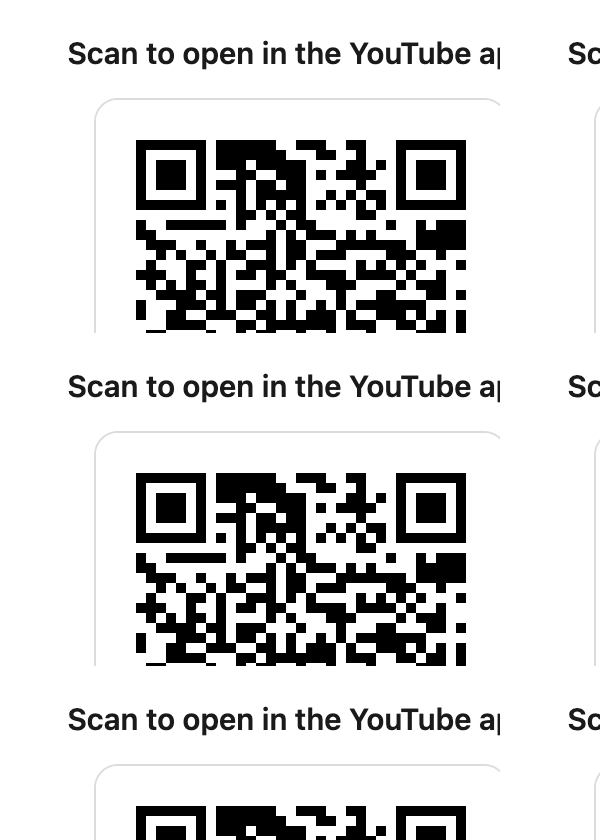
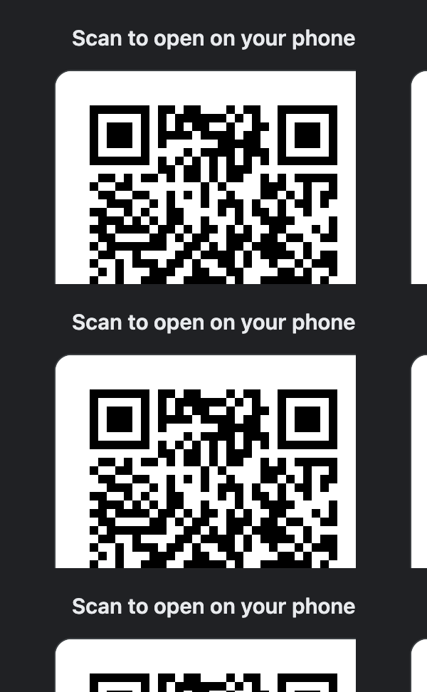
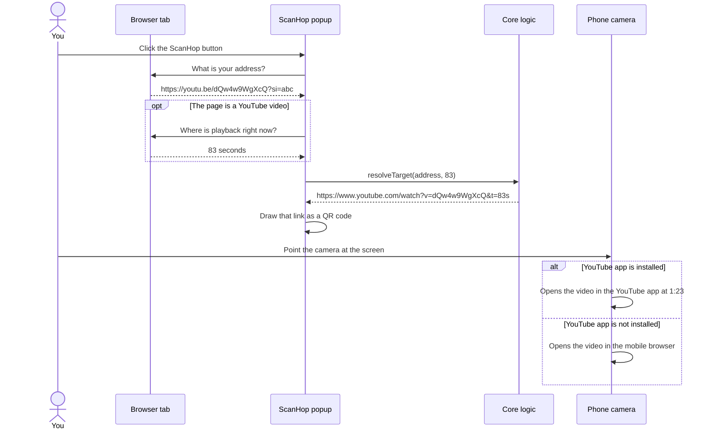
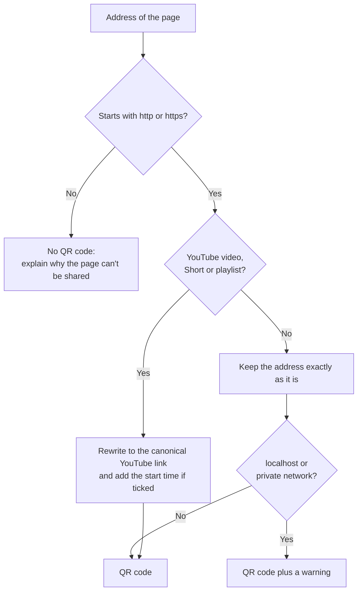
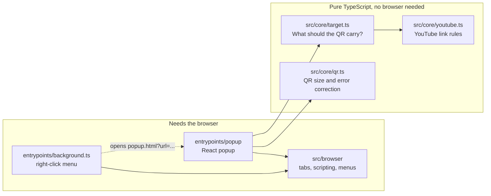

# ScanHop

ScanHop is a browser extension that shows a QR code for the page you are looking at. Scan it with your phone's camera and the same page opens on your phone. If the page is a YouTube video, the scan opens the video in the YouTube app, at the moment you were watching.

No account, no server: the QR code is made inside your browser and the page address never leaves your computer.

<p align="center">
  
  &nbsp;&nbsp;
  
</p>

## Contents

- [What it does](#what-it-does)
- [How it works](#how-it-works)
- [Getting started](#getting-started)
- [Using ScanHop](#using-scanhop)
- [How YouTube links are handled](#how-youtube-links-are-handled)
- [Architecture](#architecture)
- [Permissions and privacy](#permissions-and-privacy)
- [Testing](#testing)
- [Building and publishing](#building-and-publishing)
- [Troubleshooting](#troubleshooting)
- [Contributing](#contributing)

## What it does

| You are on…                           | Scanning the QR code…                                               |
| ------------------------------------- | ------------------------------------------------------------------- |
| Any website                           | opens the same address in your phone's browser                      |
| A YouTube video                       | opens the video in the YouTube app, optionally at the current time  |
| A YouTube Short or playlist           | opens it in the YouTube app                                         |
| YouTube Music                         | opens it in the YouTube Music app                                   |
| `localhost` or a private network page | still works, with a warning that your phone may not reach it        |
| A browser page, local file, blank tab | shows no code, and explains why the page can't be opened on a phone |

You also get **Copy link**, **Save QR image** (a 1024px PNG), a right-click menu for any page or link, and a keyboard shortcut.

Works in Chrome, Edge and Firefox (Manifest V3).

## How it works

The extension never talks to your phone. It only draws a QR code; the phone's own camera app does the rest.



The one decision the extension makes is _what text goes into the QR code_:



## Getting started

### Requirements

- [Node.js](https://nodejs.org) 22 or newer (the repo pins Node 24 in `.nvmrc`; run `nvm use` if you use nvm)
- npm (ships with Node)
- Chrome, Edge or Firefox

### Run it in development

```bash
git clone git@github.com:shashikant-k/scanhop.git
cd scanhop
npm install
npm run dev
```

`npm run dev` builds the extension, opens a fresh Chrome window with it already installed, and reloads it whenever you save a file. For Firefox, use `npm run dev:firefox`.

### Load a build by hand

1. Run `npm run build` (Chrome and Edge) or `npm run build:firefox`.
2. **Chrome / Edge:** open `chrome://extensions`, turn on **Developer mode**, click **Load unpacked** and choose `.output/chrome-mv3`.
3. **Firefox:** open `about:debugging#/runtime/this-firefox`, click **Load Temporary Add-on** and choose `.output/firefox-mv3/manifest.json`.

Pin ScanHop to the toolbar so the button is always visible.

## Using ScanHop

| Action                          | How                                                                                     |
| ------------------------------- | --------------------------------------------------------------------------------------- |
| Show the QR for the current tab | Click the ScanHop toolbar button, or press <kbd>Alt</kbd>+<kbd>Shift</kbd>+<kbd>Q</kbd> |
| Show the QR for a link          | Right-click the link → **Show QR code for this link**                                   |
| Show the QR for the page        | Right-click the page → **Show QR code for this page**                                   |
| Continue a YouTube video        | Leave **Start at 1:23** ticked (untick it to start from the beginning)                  |
| Copy the link                   | **Copy link** copies exactly what the QR code contains                                  |
| Keep the code                   | **Save QR image** downloads a PNG                                                       |

Then open your phone's camera, point it at the code, and tap the link that appears.

The shortcut can be changed at `chrome://extensions/shortcuts`, or in Firefox under **Add-ons → ⚙ → Manage Extension Shortcuts**.

## How YouTube links are handled

YouTube has many link shapes for the same video. ScanHop rewrites them all to one standard ("canonical") `https` link and removes tracking parameters:

| The tab shows                                         | The QR code contains                                  |
| ----------------------------------------------------- | ----------------------------------------------------- |
| `https://youtu.be/ID?si=…`                            | `https://www.youtube.com/watch?v=ID`                  |
| `https://m.youtube.com/watch?v=ID&feature=share`      | `https://www.youtube.com/watch?v=ID`                  |
| `https://www.youtube.com/embed/ID?start=42`           | `https://www.youtube.com/watch?v=ID&t=42s`            |
| `https://www.youtube.com/live/ID`                     | `https://www.youtube.com/watch?v=ID`                  |
| `https://www.youtube.com/watch?v=ID&list=PL…&index=3` | `https://www.youtube.com/watch?v=ID&list=PL…&index=3` |
| `https://www.youtube.com/shorts/ID?feature=share`     | `https://www.youtube.com/shorts/ID`                   |
| `https://www.youtube.com/playlist?list=PL…`           | `https://www.youtube.com/playlist?list=PL…`           |
| `https://music.youtube.com/watch?v=ID&si=…`           | `https://music.youtube.com/watch?v=ID`                |
| A video paused at 1:23, with **Start at 1:23** ticked | `https://www.youtube.com/watch?v=ID&t=83s`            |
| Home, search results, channels                        | unchanged (treated as an ordinary web page)           |

### Why a normal `https` link and not a special "app link"?

Phones already know that `https://www.youtube.com/...` belongs to the YouTube app (iOS calls this _Universal Links_, Android calls it _App Links_). When the camera reads such a link, the phone offers the app if it is installed and the mobile site if it is not.

App-only schemes such as `vnd.youtube://` or `youtube://` were rejected because many camera apps refuse QR codes that are not web addresses, and they lead nowhere when the app is missing.

One consequence: **the phone, not ScanHop, decides whether the app opens.** See [Troubleshooting](#troubleshooting) if yours opens the browser instead.

## Architecture

The code is split so that every rule can be tested without a browser. Only a thin layer touches browser APIs.



```text
scanhop/
├── entrypoints/               What the browser loads (WXT turns these into the manifest)
│   ├── background.ts          Registers the right-click menu
│   └── popup/                 The popup UI
│       ├── App.tsx            Loads the tab, decides what to show
│       ├── QrCard.tsx         Draws the QR code
│       ├── Actions.tsx        Copy link / Save QR image
│       ├── exportPng.ts       SVG → PNG download
│       └── messages.ts        All explanatory wording in one place
├── src/
│   ├── core/                  Pure logic, fully unit tested
│   │   ├── youtube.ts         Recognise and canonicalise YouTube links
│   │   ├── target.ts          resolveTarget(): the single decision point
│   │   └── qr.ts              Error correction, capacity, pixel size
│   └── browser/               The only code that calls browser APIs
│       ├── activeTab.ts       Current tab address, video playback time
│       └── contextMenu.ts     Menu entries and the "show this link" request
├── test/                      Shared test helpers (read a QR code back with ZXing)
├── e2e/                       Playwright tests against the real built extension
├── scripts/make-icons.mjs     Draws the toolbar icons (npm run icons)
├── public/icon/               Generated icons
└── wxt.config.ts              Extension name, permissions, shortcut
```

### Design decisions worth knowing

- **`resolveTarget()` is the single decision point.** The popup hands it an address and renders whatever comes back: `web`, `youtube`, or `unsupported` with a reason. New rules go there, not in the UI.
- **Ordinary addresses are never modified.** Only recognised YouTube links are rewritten. A property-based test checks that any other address comes out byte-for-byte identical.
- **The QR code is always black on white**, even in dark mode. Inverted codes scan poorly.
- **Every QR square is a whole number of pixels wide.** Fractional sizes blur the code. The first CI run caught exactly this on a long address.
- **Error correction adapts to length.** Short links use medium correction; long links drop to low so the squares stay as large as possible. Links over 2,953 bytes cannot fit in any QR code and get a clear message.
- **The right-click menu reuses the popup page.** A browser cannot open the toolbar popup for an arbitrary link, so the menu opens `popup.html?url=…` in a small window.

### Tech stack

| Tool                                                                | Why                                                                                                 |
| ------------------------------------------------------------------- | --------------------------------------------------------------------------------------------------- |
| [WXT](https://wxt.dev)                                              | One codebase builds Chrome, Edge and Firefox; generates the manifest; live reload; test integration |
| [React](https://react.dev) + TypeScript (strict)                    | Small popup UI; typed results keep the UI honest about every case                                   |
| [qrcode.react](https://github.com/zpao/qrcode.react)                | Draws the QR code as crisp SVG, entirely offline                                                    |
| [Vitest](https://vitest.dev) + [fast-check](https://fast-check.dev) | Unit, component and property-based tests                                                            |
| [Playwright](https://playwright.dev)                                | End-to-end tests in a real browser with the extension loaded                                        |
| ESLint + Prettier + `web-ext lint`                                  | Code quality, formatting, and Mozilla's own extension checks                                        |

## Permissions and privacy

ScanHop asks for the minimum, and no "read all your browsing data" permission.

| Permission     | What it is used for                                                                              |
| -------------- | ------------------------------------------------------------------------------------------------ |
| `activeTab`    | Read the address of the current tab, and only after you click the button, shortcut or menu entry |
| `scripting`    | Read the playback position of a YouTube video in that tab, for the **Start at…** option          |
| `contextMenus` | Add the two **Show QR code…** entries to the right-click menu                                    |

- Nothing is sent anywhere. There is no server, no analytics and no account.
- Nothing is stored. ScanHop keeps no history of pages you shared.
- The Firefox build declares `data_collection_permissions: none`.

> The test-only build (`--mode e2e`) additionally gets access to all pages, because automated tests cannot click the real toolbar button that grants `activeTab`. Release builds never include it; see `wxt.config.ts`.

## Testing

| Layer         | Command                                                       | What it proves                                                                                                              |
| ------------- | ------------------------------------------------------------- | --------------------------------------------------------------------------------------------------------------------------- |
| Static checks | `npm run typecheck` · `npm run lint` · `npm run format:check` | Types, code rules and formatting                                                                                            |
| Unit          | `npm test`                                                    | Every YouTube link shape, unsupported pages, network warnings, QR sizing; property tests with random input                  |
| Component     | `npm test`                                                    | The popup in every state, against a fake browser API. The rendered QR code is **decoded** and compared with the link        |
| End-to-end    | `npm run e2e`                                                 | The real built extension in Chromium: screenshot the QR code, decode it, check the link; PNG download; clipboard; dark mode |
| Firefox lint  | `npm run build:firefox && npm run lint:firefox`               | Mozilla's linter accepts the Firefox build                                                                                  |
| Real phones   | by hand, see below                                            | The phone really opens the page, and YouTube really opens the app                                                           |

First-time setup for end-to-end tests:

```bash
npx playwright install chromium
```

Useful while developing:

```bash
npm run test:watch
```

Tests never touch the internet: `youtube.com` and `example.com` are replaced with local stand-in pages.

### What automated tests cannot cover

No test can point a real phone at a real screen, click the real toolbar button, or open a native right-click menu. Check these by hand before each release:

| #   | On the computer                                     | On the phone                    | Expected                                   |
| --- | --------------------------------------------------- | ------------------------------- | ------------------------------------------ |
| 1   | Open any news article, click ScanHop                | iPhone Camera                   | Article opens in Safari                    |
| 2   | Same                                                | Android Camera / Google Lens    | Article opens in the default browser       |
| 3   | Play a YouTube video to ~1:00, click ScanHop        | iPhone with the YouTube app     | YouTube app opens at ~1:00                 |
| 4   | Same                                                | Android with the YouTube app    | YouTube app opens at ~1:00                 |
| 5   | Same, untick **Start at…**                          | Either                          | Video starts from the beginning            |
| 6   | Same as 3                                           | A phone without the YouTube app | Video opens on the mobile site             |
| 7   | Open a YouTube Short, click ScanHop                 | Either, with the app            | Opens in the Shorts player                 |
| 8   | Right-click a link → **Show QR code for this link** | Either                          | The linked page opens, not the current one |
| 9   | Press <kbd>Alt</kbd>+<kbd>Shift</kbd>+<kbd>Q</kbd>  | n/a                             | The popup opens                            |
| 10  | Repeat 1 and 3 in Firefox and in dark mode          | Either                          | Same results                               |

On Android you can also check which app would handle a link without scanning:

```bash
adb shell am start -W -a android.intent.action.VIEW -d "https://www.youtube.com/watch?v=dQw4w9WgXcQ"
```

The output should name `com.google.android.youtube`.

### Continuous integration

Every push to `main` or `dev` and every pull request runs three jobs on GitHub Actions (`.github/workflows/ci.yml`):

1. **Lint, types and unit tests**
2. **End-to-end tests** in Chromium (the Playwright report is uploaded if anything fails)
3. **Build and package** for Chrome and Firefox, run Mozilla's linter, and upload the zip files

## Building and publishing

```bash
npm run zip
```

```bash
npm run zip:firefox
```

The zips land in `.output/`. The Firefox command also creates a sources zip, which Mozilla asks for during review.

Before submitting to a store:

- Replace the placeholder Firefox add-on id `scanhop@example.com` in `wxt.config.ts` with your own.
- Check that the name "ScanHop" is free on the Chrome Web Store and Firefox Add-ons.
- Bump `version` in `package.json`.
- Run the [manual phone checks](#what-automated-tests-cannot-cover).

### All scripts

| Command                 | What it does                                        |
| ----------------------- | --------------------------------------------------- |
| `npm run dev`           | Run the extension in Chrome with live reload        |
| `npm run dev:firefox`   | Same, in Firefox                                    |
| `npm run build`         | Production build for Chrome and Edge                |
| `npm run build:firefox` | Production build for Firefox                        |
| `npm run zip`           | Build and package the Chrome/Edge zip               |
| `npm run zip:firefox`   | Build and package the Firefox zip and sources zip   |
| `npm test`              | Unit and component tests                            |
| `npm run test:watch`    | Same, re-running on every change                    |
| `npm run e2e`           | Build the test variant and run the Playwright tests |
| `npm run typecheck`     | Check types with TypeScript                         |
| `npm run lint`          | Check code with ESLint                              |
| `npm run lint:firefox`  | Check the Firefox build with Mozilla's linter       |
| `npm run format`        | Format all files with Prettier                      |
| `npm run format:check`  | Fail if any file is not formatted                   |
| `npm run icons`         | Redraw the toolbar icons                            |

## Troubleshooting

**My phone opens YouTube in the browser, not the app.**
The phone makes this choice. On Android, open **Settings → Apps → YouTube → Open by default** and allow supported links. On iPhone, long-press a YouTube link in Safari or Notes and choose **Open in YouTube** once; iOS remembers it. Third-party QR scanner apps often open links in their own built-in browser: use the phone's own camera app instead.

**The popup says "This is a browser page".**
Pages such as `chrome://settings`, the new tab page and the extensions page exist only on your computer, so there is nothing a phone could open.

**The page is on `localhost` and my phone can't open it.**
`localhost` always means "this device". Start your dev server so it listens on your network (often `--host` or `0.0.0.0`), then open it by your computer's network address, for example `http://192.168.1.20:3000`, and click ScanHop again. The phone must be on the same network.

**The QR code is very dense and hard to scan.**
Long addresses need more squares. Move the phone closer, raise the screen brightness, or shorten the address (remove tracking parameters). Addresses over 2,953 bytes cannot fit in a QR code at all.

**There is no "Start at…" option on a YouTube video.**
It appears only once the video has played for at least a second, and only for regular videos (not Shorts or playlists pages). Close the popup, let the video play briefly, and open it again.

**The right-click entries are missing.**
They are added when the extension is installed or updated. Reload the extension from the extensions page.

## Contributing

- Branch from `dev`.
- Keep commits **atomic**: one logical change each, with its tests, passing on its own.
- Write commit messages in [Conventional Commits](https://www.conventionalcommits.org) style, imperative and short, for example `feat(core): parse and canonicalise YouTube URLs`. Add a body only when the reason is not obvious from the subject.
- Before pushing, run:

```bash
npm run format && npm run lint && npm run typecheck && npm test && npm run e2e
```
